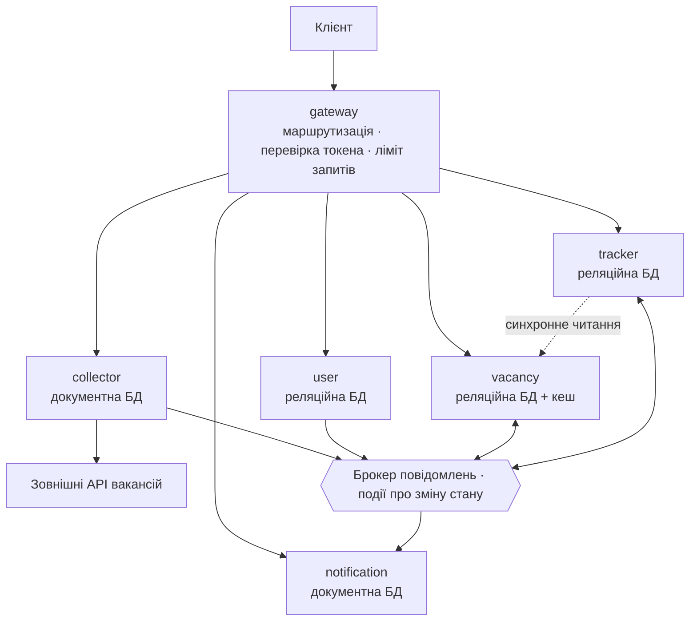

# ТЗ: JobRadar — агрегатор IT-вакансій

Версія від 11.11.2026

## 1. Мета і правила гри

JobRadar — навчальний проєкт із продовими вимогами: кілька власних сервісів, зовнішнє API вакансій, дві бази даних, брокер, кеш, аутентифікація і повний набір тестів. Мета — щоб досвідчений розробник з іншого стеку (Flutter) пройшов на практиці більшість задач, які зустрічаються в Java-бекенді на проді.

Як читати документ:

- ТЗ описує, **що** система має робити і які властивості мати, а не **чим** це реалізувати. Вибір бібліотек — частина завдання.
- Підказки щодо технологій зібрані в останньому розділі. Заглядати туди варто після власної спроби знайти рішення.
- Вимоги мають коди (`VAC-3`, `DATA-5`), щоб на них можна було посилатися в комітах і рев'ю.
- Пункти з позначкою *(бонус)* необов'язкові. Усе інше — обов'язкове.

Що зафіксовано заздалегідь:

- Мова — Java, актуальна LTS-версія. Фреймворк — Spring Boot актуальної стабільної версії.
- Усе запускається локально в Docker однією командою.
- Збірка — Maven; один сервіс навмисно на Gradle.
- Тести — юніт-тести плюс інтеграційні на справжній інфраструктурі в контейнерах.

Кожне нетривіальне рішення (вибір брокера, схема токенів, стратегія кешу) фіксується коротким ADR у `docs/adr/`: контекст, варіанти, рішення, наслідки. На проді саме це питають на рев'ю архітектури.

## 2. Продукт

JobRadar збирає IT-вакансії із зовнішніх джерел, зводить їх до єдиного формату, дає пошук і аналітику ринку, а зареєстрованим користувачам — трекер відгуків і сповіщення про нові вакансії.

### Ролі

| Роль | Що може |
| --- | --- |
| Гість | Шукати і переглядати вакансії, дивитися публічну аналітику |
| Користувач | Усе, що гість, плюс профіль із навичками, збережені пошуки, трекер відгуків, сповіщення |
| Адмін | Керувати джерелами і довідником навичок, запускати імпорт вручну, бачити журнал імпортів і недоставлені повідомлення, блокувати користувачів |

### Ключові сценарії

1. **Імпорт.** Система за розкладом забирає вакансії з двох і більше зовнішніх джерел, зберігає сирі відповіді, нормалізує і прибирає дублікати.
2. **Пошук.** Гість шукає за текстом, навичками, рівнем, вилкою, локацією, форматом роботи; результати відсортовані за релевантністю або датою.
3. **Аналітика ринку.** Медіанні вилки за навичками й рівнями, динаміка попиту по тижнях, топ навичок у кожній категорії, навички, які найчастіше йдуть у парі.
4. **Трекер відгуків.** Користувач додає вакансію до своєї воронки і веде її статусами: збережено → відгукнувся → скринінг → інтерв'ю → офер → прийняв / відмова / відкликав. Кожен перехід зберігається в історії.
5. **Сповіщення.** Користувач зберігає пошук і отримує листа, коли з'являється вакансія, що під нього підходить, а також коли відстежувана вакансія закрилась.
6. **Адміністрування.** Адмін вмикає і вимикає джерела, перезапускає невдалий імпорт, повторно обробляє недоставлені повідомлення, об'єднує синоніми навичок («JS» і «JavaScript»).

Клієнтський інтерфейс у рамки ТЗ не входить: достатньо документованого API та колекції запитів. *(бонус)* Мобільний клієнт на Flutter поверх цього API.

## 3. Архітектура

Система складається з шести власних сервісів; кожен володіє своїми даними і не читає чужу базу напряму.

Стрілки від `gateway` — HTTP-запити. Стрілки до брокера показують, хто публікує події, а хто їх споживає. Пунктир — єдиний синхронний виклик між сервісами (ARCH-3).

| Сервіс | Відповідальність | Сховище | Збірка |
| --- | --- | --- | --- |
| `gateway` | Єдина точка входу: маршрутизація, перевірка токена, обмеження частоти запитів, CORS | Сховище «ключ–значення» для лічильників | Maven |
| `user-service` | Реєстрація, вхід, токени, ролі, профіль і навички користувача | Реляційна БД | Maven |
| `collector-service` | Імпорт із зовнішніх API, сирі дані, нормалізація, журнал запусків | Документна БД | **Gradle** |
| `vacancy-service` | Каталог вакансій, компанії, довідник навичок, пошук, аналітика | Реляційна БД + кеш | Maven |
| `tracker-service` | Воронка відгуків, історія статусів, нотатки, збережені пошуки | Реляційна БД | Maven |
| `notification-service` | Зіставлення нових вакансій із підписками, надсилання листів, історія сповіщень | Документна БД | Maven |

Правила взаємодії:

- **ARCH-1.** Зовнішній клієнт бачить лише `gateway`. Інші сервіси назовні порти не відкривають.
- **ARCH-2.** Зміни стану поширюються подіями через брокер. Синхронний виклик між сервісами допускається лише для читання й лише з таймаутом і запасним варіантом.
- **ARCH-3.** Є рівно один обов'язковий синхронний виклик: `tracker-service` бере картку вакансії у `vacancy-service`.
- **ARCH-4.** Контракти подій живуть в окремому спільному модулі, який підключають усі сервіси, зокрема й той, що збирається іншим інструментом.
- **ARCH-5.** Усередині кожного сервісу шари розділені: веб-шар не бачить сутностей БД, доменна логіка не залежить від веб-фреймворку. Перетворення «сутність ↔ DTO ↔ подія» не пишеться руками поле за полем.

## 4. Функціональні вимоги по сервісах

### 4.1. collector-service (Gradle)

- **COL-1.** Кожне зовнішнє джерело — окрема реалізація спільного контракту. Додати третє джерело можна без змін у коді оркестрації. Мінімум два джерела з різними форматами відповіді та різною пагінацією.
- **COL-2.** Імпорт запускається за розкладом і вручну адміном. Коли піднято два екземпляри сервісу, один і той самий імпорт виконує лише один із них.
- **COL-3.** Сторінки одного джерела і різні джерела обробляються паралельно, але з обмеженням одночасних запитів і з дотриманням лімітів джерела. Падіння одного джерела не зриває імпорт решти.
- **COL-4.** Сира відповідь зберігається «як є» разом із джерелом, часом і ідентифікатором запуску. Сирі документи самі зникають через 30 днів.
- **COL-5.** Нормалізація: єдина модель вакансії, розбір вилки з тексту («$4–6k», «від 5000 EUR»), визначення рівня і навичок із назви та опису. Ця логіка — чисті функції без залежностей від фреймворку, покриті юніт-тестами.
- **COL-6.** Повторний імпорт тієї самої вакансії не створює дубліката і не породжує події, якщо вміст не змінився.
- **COL-7.** Кожен запуск пишеться в журнал: скільки отримано, нових, оновлених, відкинутих, тривалість, помилки. Адмін бачить зведення по джерелах за період.
- **COL-8.** Проєкт запускається і працює без інтернету та без ключів API: у локальному оточенні є заглушка зовнішнього API з реалістичними відповідями, зокрема помилками 429 і 500.

### 4.2. vacancy-service

- **VAC-1.** Приймає події про імпортовані вакансії, створює або оновлює запис, прив'язує компанію та навички. Обробка пачки з 500 вакансій не робить 500 окремих вставок.
- **VAC-2.** Одна й та сама вакансія з двох джерел склеюється в один запис із переліком джерел.
- **VAC-3.** Пошук із довільною комбінацією фільтрів (текст, навички «всі з» / «будь-яка з», рівень, вилка, локація, віддалено, дата публікації, компанія). Фільтри збираються динамічно, без окремого методу на кожну комбінацію.
- **VAC-4.** Повнотекстовий пошук із ранжуванням: збіг у назві важить більше, ніж збіг в описі.
- **VAC-5.** Два режими пагінації: за номером сторінки для адмінки і за курсором для стрічки, яка не деградує на глибоких сторінках.
- **VAC-6.** Довідник навичок — дерево (Development → Backend → Java → Spring) із синонімами. Фільтр за вузлом дерева знаходить вакансії з усіма нащадками.
- **VAC-7.** Аналітичні ендпоїнти з розділу 5.3.
- **VAC-8.** Вакансія, якої не було в трьох останніх імпортах свого джерела, позначається закритою. Закриті не видаляються фізично і не потрапляють у пошук за замовчуванням.
- **VAC-9.** Вилки в різних валютах порівнюються в єдиній валюті. *(бонус)* Курси беруться з другого зовнішнього API раз на добу.
- **VAC-10.** Експорт результатів пошуку в CSV потоком: 100 000 рядків не завантажуються в пам'ять цілком.

### 4.3. tracker-service

- **TRK-1.** Користувач додає вакансію у воронку. Картка зберігає знімок ключових полів вакансії, отриманий із `vacancy-service` у момент додавання.
- **TRK-2.** Статуси — скінченний автомат. Недозволений перехід («відмова» → «інтерв'ю») відхиляється з зрозумілою помилкою.
- **TRK-3.** Зміна статусу, запис в історію і публікація події — атомарні: або все, або нічого (див. DATA-7).
- **TRK-4.** Два одночасні редагування однієї картки не затирають одне одного мовчки: другий запит отримує конфлікт.
- **TRK-5.** Ліміт — 50 активних карток на користувача. Ліміт не перевищується навіть при 20 паралельних запитах від одного користувача.
- **TRK-6.** Збережені пошуки: набір фільтрів із VAC-3 плюс частота сповіщень (одразу / раз на день).
- **TRK-7.** Особиста статистика: конверсія між етапами воронки і середній час на кожному етапі.
- **TRK-8.** Коли `vacancy-service` недоступний, перегляд воронки працює зі знімків, а додавання нової картки швидко повертає зрозумілу помилку, а не висить.

### 4.4. notification-service

- **NTF-1.** На нову вакансію знаходить усі збережені пошуки, під які вона підходить, і формує сповіщення. Копію підписок сервіс тримає в себе й оновлює за подіями.
- **NTF-2.** Повторно доставлена подія не призводить до другого листа.
- **NTF-3.** Режим «раз на день» збирає збіги за добу в один дайджест.
- **NTF-4.** Канал доставки — розширювана абстракція: обов'язково email (у локальному оточенні — поштова пісочниця з веб-інтерфейсом). *(бонус)* Telegram або push.
- **NTF-5.** Листи формуються за шаблонами; надсилання не блокує обробку наступних подій.
- **NTF-6.** Історія сповіщень користувача зі статусом доставки доступна через API.
- **NTF-7.** Повідомлення, які не вдалося обробити після повторів, не губляться: адмін бачить їх і може запустити повторно.

### 4.5. user-service

- **USR-1.** Реєстрація з підтвердженням email, вхід, вихід, зміна і відновлення пароля.
- **USR-2.** Профіль: бажана позиція, рівень, навички з довідника, очікувана вилка.
- **USR-3.** Ролі та блокування користувача адміном. Заблокований користувач втрачає доступ не пізніше ніж за хвилину, а не після закінчення токена.
- **USR-4.** Усі чутливі дії (вхід, зміна пароля, зміна ролі) потрапляють в аудит-журнал. Запис про невдалу спробу зберігається, навіть коли основна операція відкотилась.
- **USR-5.** Видалення акаунта прибирає персональні дані в усіх сервісах — через подію, не прямими викликами.

### 4.6. gateway

- **GW-1.** Маршрутизація за префіксом шляху, перевірка токена до передачі запиту далі.
- **GW-2.** Обмеження частоти: різні ліміти для гостя (за IP) і користувача (за ідентифікатором). Ліміт працює коректно, коли екземплярів `gateway` два.
- **GW-3.** Кожен запит отримує наскрізний ідентифікатор, який видно в логах усіх сервісів на шляху, зокрема й після проходження через брокер.

### 4.7. Мапа вимог по сервісах

Кожна таблиця показує, які наскрізні вимоги з розділів 3 і 5–12 реалізуються в сервісі, крім його власних. Бонусні вимоги позначено зірочкою.

**collector-service** — власні COL-1…COL-8

| Область | Вимоги |
| --- | --- |
| Архітектура | ARCH-1, ARCH-2, ARCH-4, ARCH-5 |
| Дані | DATA-7 (у документній БД), DATA-18, DATA-19, DATA-20, DATA-22 |
| Події | MSG-2, MSG-4, MSG-6 — лише публікує |
| REST API | API-1…API-4, API-8 (адмінські ендпоїнти) |
| Потоки й мова | CONC-1…CONC-6, LANG-1, LANG-2, LANG-4 |
| Безпека | SEC-5…SEC-8 |
| Експлуатація | OPS-1…OPS-7 |
| Збірка | BLD-2…BLD-9 |
| Тести | TST-1…TST-4, TST-6, TST-7, TST-8 (CONC-2), TST-9, TST-10 |

**vacancy-service** — власні VAC-1…VAC-10

| Область | Вимоги |
| --- | --- |
| Архітектура | ARCH-1…ARCH-5 (сторона, що відповідає в ARCH-3) |
| Дані | DATA-1, DATA-2, DATA-4…DATA-8, DATA-11…DATA-17 |
| Нативний SQL | SQL-1…SQL-8, SQL-10 |
| Події | MSG-1…MSG-6 — споживає і публікує |
| REST API | API-1…API-4, API-7, API-8 |
| Кеш | CACHE-1…CACHE-6, CACHE-7\* |
| Потоки й мова | CONC-4, CONC-5, LANG-1, LANG-2, LANG-4 |
| Безпека | SEC-5…SEC-8 |
| Експлуатація | OPS-1, OPS-3…OPS-7, OPS-8\* |
| Збірка | BLD-1, BLD-3…BLD-9 |
| Тести | TST-1, TST-3, TST-4, TST-5, TST-7, TST-8 (DATA-8, CACHE-4), TST-9, TST-10, TST-11\* |

**tracker-service** — власні TRK-1…TRK-8

| Область | Вимоги |
| --- | --- |
| Архітектура | ARCH-1…ARCH-5 (сторона, що викликає в ARCH-3) |
| Дані | DATA-1, DATA-3, DATA-4, DATA-6…DATA-9, DATA-11 |
| Нативний SQL | SQL-8, SQL-9 |
| Події | MSG-1…MSG-6 — споживає і публікує |
| REST API | API-1…API-6, API-8, API-9, API-10\* |
| Потоки й мова | CONC-4, CONC-5, LANG-1, LANG-2, LANG-4 |
| Безпека | SEC-5…SEC-8 |
| Експлуатація | OPS-1…OPS-7 |
| Збірка | BLD-1, BLD-3…BLD-9 |
| Тести | TST-1…TST-5, TST-7, TST-8 (TRK-4, TRK-5, DATA-8), TST-9, TST-10, TST-11\* |

**notification-service** — власні NTF-1…NTF-7

| Область | Вимоги |
| --- | --- |
| Архітектура | ARCH-1, ARCH-2, ARCH-4, ARCH-5 |
| Дані | DATA-21, DATA-22 |
| Події | MSG-1…MSG-6, MSG-7\* — лише споживає |
| REST API | API-1…API-4, API-8, API-10\* |
| Потоки й мова | CONC-4, CONC-5, LANG-1, LANG-2, LANG-4 |
| Безпека | SEC-5…SEC-8 |
| Експлуатація | OPS-1, OPS-3…OPS-7 |
| Збірка | BLD-1, BLD-3…BLD-9 |
| Тести | TST-1, TST-3, TST-4, TST-7, TST-9, TST-10 |

**user-service** — власні USR-1…USR-5

| Область | Вимоги |
| --- | --- |
| Архітектура | ARCH-1, ARCH-2, ARCH-4, ARCH-5 |
| Дані | DATA-1, DATA-4, DATA-6, DATA-7, DATA-8, DATA-10, DATA-11 |
| Нативний SQL | SQL-8 |
| Події | MSG-2, MSG-4, MSG-6 — лише публікує |
| REST API | API-1…API-4, API-6, API-8, API-10\* |
| Потоки й мова | CONC-4, CONC-5, LANG-1, LANG-3, LANG-4 |
| Безпека | SEC-1…SEC-8, SEC-9\* — тут видаються токени |
| Експлуатація | OPS-1, OPS-3…OPS-7 |
| Збірка | BLD-1, BLD-3…BLD-9 |
| Тести | TST-1, TST-3, TST-4, TST-7, TST-8 (DATA-8), TST-9, TST-10 |

**gateway** — власні GW-1…GW-3

| Область | Вимоги |
| --- | --- |
| Архітектура | ARCH-1 |
| REST API | API-2, API-8 (зведена документація), API-10\* |
| Потоки й мова | CONC-5, LANG-4 |
| Безпека | SEC-1, SEC-3, SEC-7, SEC-8 |
| Експлуатація | OPS-1, OPS-3…OPS-7 |
| Збірка | BLD-1, BLD-3…BLD-9 |
| Тести | TST-1, TST-3, TST-4, TST-9, TST-10 |

## 5. Дані

### 5.1. Реляційна модель і ORM

- **DATA-1.** Схема БД створюється й змінюється лише версіонованими міграціями, що лежать у репозиторії. Автогенерацію схеми з коду вимкнено; на старті сервіс лише перевіряє відповідність.
- **DATA-2.** У моделі `vacancy-service` є щонайменше: зв'язок «багато до багатьох» з атрибутами (вакансія–навичка: обов'язкова чи бажана), зв'язок «один до багатьох», самопосилання (дерево навичок), вбудований об'єкт-значення (вилка: від, до, валюта), переліки, поле з довільною структурою (додаткові атрибути джерела).
- **DATA-3.** У `notification-service` або `tracker-service` є ієрархія сутностей зі спільним предком; обрана стратегія відображення на таблиці обґрунтована в ADR.
- **DATA-4.** Усі сутності мають поля аудиту (коли і ким створено та змінено), які заповнюються автоматично, без коду в сервісах.
- **DATA-5.** Проблема «N+1 запитів» спершу відтворена тестом, який рахує SQL-запити на списку вакансій із навичками, а потім усунена. Тест фіксує верхню межу кількості запитів. Випробувано щонайменше два способи усунення.
- **DATA-6.** Ліниві зв'язки не завантажуються під час формування HTTP-відповіді: сесія БД закривається на межі сервісного шару. Пул з'єднань налаштовано свідомо, розмір обґрунтовано.

### 5.2. Транзакції і блокування

- **DATA-7.** Зміна бізнес-стану і подія про неї фіксуються однією транзакцією в БД сервісу. Подія не може піти в брокер без збереженої зміни, і зміна не може зберегтися без події, навіть якщо сервіс впав між двома кроками.
- **DATA-8.** Невідправлені події розбирають кілька екземплярів сервісу одночасно, не беручи один і той самий рядок і не чекаючи один на одного.
- **DATA-9.** TRK-4 розв'язано без блокування рядків на час редагування; TRK-5 — так, щоб перевірка ліміту і вставка не розходилися під конкуренцією. Обидва рішення підтверджені багатопотоковими тестами.
- **DATA-10.** USR-4 потребує операції, що фіксується незалежно від зовнішньої транзакції. В ADR пояснено, чому виклик транзакційного методу з того самого класу «не працює» і як це обійдено.
- **DATA-11.** Читальні операції позначені як такі. Зовнішні HTTP-виклики й надсилання листів не виконуються всередині відкритої транзакції.
- **DATA-12.** Є тест, який показує різницю між двома рівнями ізоляції на прикладі перерахунку статистики під час імпорту.

### 5.3. Запити, які пишуться лише нативним SQL

Кожен запит нижче — окремий ендпоїнт або фонова задача. Результат відображається на типізовані незмінні об'єкти, не на масиви `Object[]`.

| Код | Що повертає | Чому не виразити мовою запитів ORM |
| --- | --- | --- |
| SQL-1 | Медіана, 25-й і 75-й перцентилі вилки за навичкою та рівнем | Впорядковані агрегати |
| SQL-2 | Кількість нових вакансій за навичкою по тижнях і зміна до попереднього тижня у відсотках; тижні без вакансій присутні з нулем | Віконні функції, генерація ряду дат |
| SQL-3 | Топ-5 навичок у кожній категорії за останні 30 днів | Ранжування в межах групи |
| SQL-4 | Кількість вакансій для вузла дерева навичок з усіма нащадками (VAC-6) | Рекурсивний обхід ієрархії |
| SQL-5 | Повнотекстовий пошук із вагою полів і підсвіткою фрагмента (VAC-4) | Специфічні типи й оператори СУБД |
| SQL-6 | Пари навичок, що найчастіше трапляються разом | Самоз'єднання з агрегацією й фільтром на порядок пари |
| SQL-7 | Пакетна вставка «створити або оновити» з поверненням ознаки, що саме сталося з кожним рядком (VAC-1) | Конфлікт по унікальному ключу в одному операторі |
| SQL-8 | Вибірка пачки невідправлених подій із пропуском рядків, зайнятих іншим екземпляром (DATA-8) | Рядкові блокування з пропуском |
| SQL-9 | Конверсія воронки й середній час між статусами за історією переходів (TRK-7) | Віконні функції над послідовністю подій |
| SQL-10 | Стрічка вакансій із пагінацією за курсором по парі «дата, ідентифікатор» (VAC-5) | Порівняння кортежів |

- **DATA-13.** Важка аналітика (SQL-1, SQL-2) не рахується на кожен запит користувача: результат підготовлений заздалегідь і оновлюється після імпорту, не блокуючи читання.

### 5.4. Індекси

- **DATA-14.** У тестовій базі не менше 500 000 згенерованих вакансій; скрипт генерації лежить у репозиторії.
- **DATA-15.** Для пошуку, стрічки та кожного запиту з 5.3 в `docs/performance.md` зафіксовано план виконання і час **до** та **після** додавання індексу. Індекс без такого заміру не додається.
- **DATA-16.** У схемі є і обґрунтовані щонайменше: складений індекс із продуманим порядком колонок; частковий індекс лише по відкритих вакансіях; унікальний індекс як захист від дублікатів (джерело + зовнішній ідентифікатор); індекс для повнотекстового пошуку; покривний індекс, який дає відповідь без звернення до таблиці; індекси на зовнішніх ключах.
- **DATA-17.** Задокументовано один випадок, коли індекс не допоміг або не був використаний планувальником, і пояснено чому.

### 5.5. Документна БД

- **DATA-18.** Сирі вакансії різних джерел мають різну структуру й лежать в одній колекції без приведення до спільної схеми.
- **DATA-19.** Автовидалення з COL-4 робить сама база, не фонова задача в коді.
- **DATA-20.** Зведення з COL-7 рахується на боці бази одним запитом-конвеєром, а не вивантаженням документів у застосунок.
- **DATA-21.** Збережені пошуки в `notification-service` проіндексовані так, щоб зіставлення однієї вакансії з 100 000 підписок не вимагало повного перебору колекції.
- **DATA-22.** В ADR пояснено, чому ці дані лежать у документній БД, а каталог і трекер — у реляційній.

## 6. Асинхронна взаємодія

Сервіси обмінюються подіями через брокер повідомлень із гарантією «щонайменше один раз».

| Подія | Публікує | Споживає |
| --- | --- | --- |
| Вакансію імпортовано | `collector-service` | `vacancy-service` |
| Імпорт джерела завершено | `collector-service` | `vacancy-service` |
| Вакансію опубліковано / оновлено / закрито | `vacancy-service` | `notification-service`, `tracker-service` |
| Збережений пошук створено / змінено / видалено | `tracker-service` | `notification-service` |
| Статус відгуку змінено | `tracker-service` | `notification-service` |
| Користувача зареєстровано / заблоковано / видалено | `user-service` | усі сервіси з даними користувача |

- **MSG-1.** Кожен споживач ідемпотентний: повторна доставка тієї самої події не змінює результат. Це покрито тестом для кожного споживача.
- **MSG-2.** Події однієї вакансії обробляються в порядку публікації; події різних вакансій — паралельно.
- **MSG-3.** Помилки поділено на тимчасові й постійні. Тимчасові повторюються зі зростаючою паузою; постійні та вичерпані повтори йдуть у чергу недоставлених із причиною помилки. Одне «отруйне» повідомлення не зупиняє обробку наступних.
- **MSG-4.** Контракт події версіонований. Споживач старої версії не падає на події з новим необов'язковим полем. Кожна подія має ідентифікатор, тип, версію, час і наскрізний ідентифікатор запиту.
- **MSG-5.** Підняття другого екземпляра `notification-service` прискорює обробку й не призводить до подвійних листів. Зупинка екземпляра посеред обробки не губить повідомлень.
- **MSG-6.** Події всередині коду — закрита ієрархія незмінних типів; обробник не компілюється, якщо додано новий тип події, а гілку для нього не написано.
- **MSG-7.** *(бонус)* Повне перестворення копії даних у `notification-service` повторним читанням історії подій з початку.

## 7. REST API

- **API-1.** Ресурсні URL, коректні методи й коди відповіді (201 із `Location`, 204, 400, 401, 403, 404, 409, 422, 429). Версія API є в шляху або в заголовку.
- **API-2.** Єдиний машиночитний формат помилки в усіх сервісах: тип, заголовок, деталі, наскрізний ідентифікатор, для помилок валідації — перелік полів. Стек-трейси й тексти SQL-помилок назовні не виходять. Обробка винятків зосереджена в одному місці, а не в кожному контролері.
- **API-3.** Вхідні дані валідуються декларативно. Є щонайменше одне власне правило рівня об'єкта («вилка від» не більша за «вилку до») і різні набори правил для створення й оновлення.
- **API-4.** Списки завжди пагіновані, з межею на розмір сторінки; сортування дозволене лише за білим списком полів.
- **API-5.** Створення картки в трекері безпечно повторювати: два однакові запити з одним ключем ідемпотентності створюють одну картку.
- **API-6.** Часткове оновлення ресурсу розрізняє «поле не передано» і «поле очищено».
- **API-7.** Картка вакансії підтримує умовні запити: незмінений ресурс повертає 304 без тіла.
- **API-8.** Контракт кожного сервісу описано машиночитною специфікацією, згенерованою з коду, з інтерактивною сторінкою. `gateway` показує зведену документацію всіх сервісів.
- **API-9.** Клієнт `tracker-service` → `vacancy-service` описаний декларативно (інтерфейсом), має таймаути на з'єднання й читання, обмежені повтори лише для безпечних запитів і передає далі наскрізний ідентифікатор та контекст користувача.
- **API-10.** *(бонус)* Сторінка «огляд»: один запит паралельно збирає профіль, воронку й свіжі збіги з трьох сервісів; відмова одного дає часткову відповідь, а не помилку.

## 8. Кешування, конкурентність і мова

### 8.1. Кеш

- **CACHE-1.** Кешуються: картка вакансії за ідентифікатором, довідник навичок, результати аналітики, курси валют. Для кожного виду даних свій час життя, обґрунтований в ADR.
- **CACHE-2.** Кеш спільний для всіх екземплярів сервісу й переживає перезапуск застосунку.
- **CACHE-3.** Оновлення або закриття вакансії інвалідує її картку в кеші. Застарілі дані не віддаються довше ніж заявлений час життя.
- **CACHE-4.** Коли запис протух під навантаженням, дорогий запит до БД виконує один потік, а не сто одночасно. Є тест, що це показує.
- **CACHE-5.** Відсутність ресурсу теж кешується, але коротко, щоб запити неіснуючих ідентифікаторів не били по БД.
- **CACHE-6.** Недоступність кешу сповільнює сервіс, але не ламає його.
- **CACHE-7.** *(бонус)* Дворівневий кеш: локальний у пам'яті перед розподіленим для довідника навичок.

### 8.2. Багатопотоковість

- **CONC-1.** Паралельний імпорт із COL-3: обмежений пул, таймаут на кожне завдання й на імпорт загалом, коректне скасування незавершених завдань, збір часткових результатів. Помилка в одному завданні не губиться мовчки.
- **CONC-2.** Обмежувач запитів до зовнішнього API (не більше N за хвилину) спершу написано власноруч на примітивах синхронізації і покрито тестом на гонки; після цього дозволено замінити бібліотечним.
- **CONC-3.** Лічильники поточного запуску імпорту (COL-7) оновлюються з багатьох потоків без втрат і без глобального блокування.
- **CONC-4.** Фонові задачі (імпорт, дайджест, закриття застарілих вакансій, відправка подій) мають окремі іменовані пули й не забирають потоки в обробки HTTP-запитів.
- **CONC-5.** Наскрізний ідентифікатор і контекст користувача не губляться при переході в інший потік.
- **CONC-6.** В ADR порівняно класичний пул потоків і легкі потоки платформи на задачі імпорту, з цифрами заміру.

### 8.3. Можливості мови

- **LANG-1.** Нормалізація й підрахунки в пам'яті написані функціонально: потокова обробка колекцій, групування, злиття, власні компаратори. Жодних `null` як сигналу «не знайдено» в публічних методах.
- **LANG-2.** DTO, події та об'єкти-значення незмінні. Джерела вакансій і канали сповіщень — стратегії за спільним узагальненим інтерфейсом, які підхоплюються автоматично.
- **LANG-3.** Одна наскрізна поведінка (аудит дій або замір часу виконання) підключається власною анотацією на методі, без коду всередині самого методу.
- **LANG-4.** Власна ієрархія винятків домену, відображена на коди відповіді з API-2. Налаштування читаються в типізовані об'єкти з валідацією на старті.

## 9. Безпека

- **SEC-1.** Аутентифікація без серверних сесій: короткоживучий токен доступу (до 15 хв) і довгоживучий токен оновлення. Токен доступу перевіряється без звернення до `user-service`.
- **SEC-2.** Токен оновлення одноразовий: при використанні видається нова пара. Повторне пред'явлення вже використаного токена відкликає всі сесії користувача.
- **SEC-3.** Вихід і блокування (USR-3) роблять уже виданий токен доступу недійсним до закінчення його строку.
- **SEC-4.** Паролі зберігаються лише у вигляді повільного хешу з сіллю. П'ять невдалих входів поспіль тимчасово блокують вхід. Відповідь на вхід і відновлення пароля не розкриває, чи існує такий email.
- **SEC-5.** Авторизація на двох рівнях: за роллю (адмінські ендпоїнти) і за власністю (користувач бачить і змінює лише свої картки та пошуки). Спроба прочитати чужий ресурс покрита тестом у кожному сервісі.
- **SEC-6.** Сервіси не довіряють запиту лише тому, що він прийшов із внутрішньої мережі: кожен сам перевіряє токен. Виклики «сервіс → сервіс» без користувача мають власну ідентичність.
- **SEC-7.** Секретів у репозиторії немає: ключі API, паролі БД і ключ підпису приходять із оточення; є `.env.example`. Ключ підпису асиметричний: приватна частина є лише в `user-service`.
- **SEC-8.** Службові ендпоїнти (метрики, стан) недоступні ззовні через `gateway`. Персональні дані й токени не потрапляють у логи.
- **SEC-9.** *(бонус)* Вхід через зовнішнього провайдера (GitHub або Google). Альтернативна гілка проєкту, де власну видачу токенів замінено готовим сервером ідентичності в контейнері.

## 10. Надійність і спостережуваність

- **OPS-1.** Кожен зовнішній виклик (стороннє API, інший сервіс, пошта) має таймаут. Повтори — з обмеженням кількості, зростаючою паузою й випадковим розкидом.
- **OPS-2.** Коли зовнішнє джерело стабільно не відповідає, сервіс на певний час перестає його викликати, а потім обережно перевіряє відновлення. Стан цього запобіжника видно в метриках.
- **OPS-3.** Проби живості й готовності розділені: сервіс із недоступною БД живий, але не готовий. При зупинці сервіс завершує поточні запити й обробку повідомлень і лише потім виходить.
- **OPS-4.** Логи структуровані, з наскрізним ідентифікатором. За одним ідентифікатором можна простежити шлях «HTTP-запит → подія → лист» через усі сервіси.
- **OPS-5.** Метрики: технічні (час відповіді, помилки, пул з'єднань, відставання споживача, влучання в кеш) і щонайменше три бізнесові (імпортовано вакансій, надіслано сповіщень, розмір черги недоставлених). Є готовий дашборд.
- **OPS-6.** Розподілене трасування: один запит видно як дерево викликів із часом кожного кроку, зокрема запитів до БД і брокера.
- **OPS-7.** Налаштування розділені за профілями (локальний, тестовий, «прод»). Вмикання джерела й зміна розкладу імпорту не потребують перезбирання.
- **OPS-8.** *(бонус)* Навантажувальний тест пошуку з ціллю: 95-й перцентиль часу відповіді до 300 мс на базі з DATA-14 при 50 одночасних користувачах.

## 11. Збірка й локальне оточення

- **BLD-1.** Один репозиторій. П'ять сервісів і спільний модуль контрактів — багатомодульний Maven-проєкт: версії залежностей і плагінів задані в одному місці, жодної версії в дочірніх модулях.
- **BLD-2.** `collector-service` збирається Gradle і підключає той самий модуль контрактів, зібраний Maven. Версії залежностей між двома збірками не розходяться.
- **BLD-3.** Збірка відтворювана на чистій машині, де є лише JDK і Docker: обгортки інструментів збірки лежать у репозиторії.
- **BLD-4.** Кожен сервіс має багатоетапний образ: збірка окремо, запуск на мінімальному образі, не від root. Шари образу впорядковані так, щоб зміна коду не перезбирала шар із залежностями.
- **BLD-5.** `docker compose up` піднімає все: шість сервісів, обидві БД, брокер, кеш, поштову пісочницю, заглушку зовнішнього API, метрики й трасування. Сервіси стартують лише після готовності своїх залежностей, а не просто після їхнього запуску.
- **BLD-6.** Є окремий режим «лише інфраструктура», щоб запускати сервіс із IDE і дебажити. Дані БД переживають перезапуск контейнерів.
- **BLD-7.** Після першого запуску система не порожня: є адмін, тестовий користувач, довідник навичок і перший імпорт із заглушки.
- **BLD-8.** Конвеєр CI на кожен пуш: збірка, статичні перевірки стилю, юніт- та інтеграційні тести, звіт покриття. Червоний конвеєр блокує злиття.
- **BLD-9.** `README` веде нову людину від клонування до першого успішного запиту за 10 хвилин: передумови, команди, адреси інтерфейсів, тестові облікові дані.

## 12. Тестування

- **TST-1.** Юніт-тести на всю доменну логіку: нормалізація вакансій, розбір вилок, автомат статусів, зіставлення з підписками. Без підняття контексту фреймворку, весь набір одного сервісу виконується за секунди.
- **TST-2.** Розбір вилок і переходи статусів покриті табличними (параметризованими) тестами: один тест, багато рядків даних.
- **TST-3.** Тести окремих шарів з частковим контекстом: веб-шар (валідація, коди відповіді, формат помилок, права доступу) і шар даних.
- **TST-4.** Інтеграційні тести працюють із тією самою СУБД, брокером і кешем, що й «прод», піднятими в контейнерах із тесту. Вбудовані БД у пам'яті не використовуються. Контейнери перевикористовуються між тестовими класами.
- **TST-5.** Кожен запит із розділу 5.3 має інтеграційний тест на підготовленому наборі даних із відомою відповіддю. Міграції проганяються в тестах з нуля.
- **TST-6.** Клієнти зовнішніх API тестуються проти HTTP-заглушки: успіх, пагінація, 429 із заголовком паузи, 500, таймаут, битий JSON.
- **TST-7.** Асинхронні сценарії перевіряються без `sleep`: тест чекає на умову з таймаутом. Покрито: подія → споживач → зміна в БД; повторна доставка (MSG-1); шлях у чергу недоставлених (MSG-3).
- **TST-8.** Багатопотокові тести на TRK-4, TRK-5, DATA-8, CACHE-4, CONC-2.
- **TST-9.** Один наскрізний тест на піднятому оточенні: реєстрація → збережений пошук → імпорт із заглушки → лист у поштовій пісочниці.
- **TST-10.** Покриття доменного й сервісного шарів не нижче 80 % рядків; поріг перевіряє збірка. Тести не залежать від порядку запуску й поточного часу: годинник підмінюється.
- **TST-11.** *(бонус)* Тести архітектурних правил із ARCH-5; контрактний тест між `tracker-service` і `vacancy-service`.

## 13. Етапи й приймання

Кожен етап закінчується робочою системою, зеленим конвеєром і тегом у репозиторії.

1. **Каркас.** Репозиторій, обидві збірки, спільний модуль, інфраструктура в Docker, CI, порожні сервіси з пробами готовності. *Готово, коли:* одна команда піднімає все, конвеєр зелений.
2. **Користувачі й вхід.** `user-service`, `gateway`, розділ 9. *Готово, коли:* захищений ендпоїнт будь-якого сервісу відхиляє запит без токена й із чужим ресурсом.
3. **Імпорт.** `collector-service`, заглушка зовнішнього API, документна БД, паралельність. *Готово, коли:* імпорт із двох джерел проходить і переживає відмову одного з них.
4. **Каталог і пошук.** Брокер, `vacancy-service`, реляційна модель, VAC-1…VAC-6. *Готово, коли:* імпортована вакансія знаходиться пошуком через `gateway`.
5. **Трекер.** `tracker-service`, транзакції й блокування, синхронний виклик із запасним варіантом. *Готово, коли:* багатопотокові тести з TST-8 зелені.
6. **Сповіщення.** `notification-service`, ідемпотентність, повтори, черга недоставлених. *Готово, коли:* наскрізний тест TST-9 зелений.
7. **Аналітика й швидкість.** Розділи 5.3 і 5.4, кеш. *Готово, коли:* `docs/performance.md` містить заміри до і після для кожного запиту.
8. **Експлуатація.** Розділ 10, дашборд, бонуси. *Готово, коли:* за ідентифікатором запиту видно весь його шлях.

Проєкт прийнято, коли:

- [ ] чиста машина з JDK і Docker: клонування, одна команда, робоча система з даними;
- [ ] усі обов'язкові вимоги закрито, для кожної є тест або запис у документації, що її підтверджує;
- [ ] зупинка будь-якого одного контейнера (сервіс, брокер, кеш) не призводить до втрати даних, а після його повернення система доганяє сама;
- [ ] два екземпляри кожного сервісу працюють одночасно без дублів і гонок;
- [ ] є ADR на кожне рішення, де ТЗ цього вимагає, і `docs/performance.md`;
- [ ] рев'ю коду від Java-розробника пройдено, зауваження закрито.

## 14. Підказки (спойлери)

Це не вимоги, а напрямки пошуку: те, що найчастіше стоїть за відповідною вимогою на Java-проєктах. Інший обґрунтований вибір приймається.

| Вимоги | Що гуглити |
| --- | --- |
| ARCH-5 | MapStruct (і його взаємодія з Lombok та records), шарувата або гексагональна архітектура |
| GW-1…GW-3 | Spring Cloud Gateway, Redis-обмежувач частоти, фільтри, W3C Trace Context |
| COL-1, LANG-2 | Патерн «Стратегія», впровадження `List<T>` у Spring, `RestClient` / `WebClient`, records |
| COL-2, CONC-4 | `@Scheduled`, ShedLock, `ThreadPoolTaskExecutor`, `@Async` |
| COL-3, CONC-1…CONC-6 | `ExecutorService`, `CompletableFuture`, `Semaphore`, `ConcurrentHashMap`, `LongAdder`, віртуальні потоки, structured concurrency, `ThreadLocal` і MDC |
| COL-8, TST-6 | WireMock (у тестах і як контейнер) |
| DATA-1 | Flyway або Liquibase, `ddl-auto=validate` |
| DATA-2…DATA-6 | Spring Data JPA, Hibernate: проміжна сутність замість `@ManyToMany`, `@Embeddable`, `AttributeConverter`, JSONB, `@Inheritance`, Spring Data Auditing, `@EntityGraph`, `JOIN FETCH`, `@BatchSize`, `open-in-view=false`, HikariCP, `equals`/`hashCode` для сутностей |
| VAC-1, SQL-7 | JDBC batching, `INSERT … ON CONFLICT … RETURNING` |
| VAC-3 | JPA Specification, Criteria API, Querydsl |
| VAC-8 | Soft delete в Hibernate (`@SoftDelete`, `@SQLRestriction`) |
| VAC-10 | `StreamingResponseBody`, `Stream<T>` із репозиторію, fetch size |
| TRK-2, MSG-6 | `enum` із поведінкою, sealed-інтерфейси, pattern matching у `switch` |
| DATA-7 | Transactional Outbox; *(бонус)* Debezium і CDC |
| DATA-8, SQL-8 | `SELECT … FOR UPDATE SKIP LOCKED` |
| DATA-9 | `@Version` (оптимістичне блокування), `PESSIMISTIC_WRITE`, advisory locks |
| DATA-10, DATA-11 | `@Transactional`: propagation, `REQUIRES_NEW`, `readOnly`, проксі та self-invocation, `TransactionTemplate`, `@TransactionalEventListener` |
| DATA-12 | Read Committed проти Repeatable Read у PostgreSQL, MVCC |
| SQL-1…SQL-6, SQL-9, SQL-10 | PostgreSQL: `percentile_cont … WITHIN GROUP`, `LAG`, `generate_series`, `ROW_NUMBER` / `RANK`, `WITH RECURSIVE`, `tsvector`, `ts_rank`, `ts_headline`, порівняння кортежів, keyset pagination |
| Відображення нативних запитів | `@Query(nativeQuery = true)`, інтерфейсні проєкції, `@SqlResultSetMapping`, `JdbcClient`, jOOQ |
| DATA-13 | `MATERIALIZED VIEW`, `REFRESH … CONCURRENTLY` |
| DATA-14…DATA-17 | `EXPLAIN (ANALYZE, BUFFERS)`, B-tree, GIN, partial і covering (`INCLUDE`) індекси, `pg_stat_statements`, Datafaker |
| DATA-18…DATA-22 | MongoDB, Spring Data MongoDB: TTL-індекс, aggregation pipeline, складені та multikey-індекси |
| MSG-1…MSG-7 | Apache Kafka (KRaft), Spring for Apache Kafka: ключ партиції, consumer group, керування офсетами, retry topics, dead letter topic, таблиця оброблених подій; альтернатива — RabbitMQ; *(бонус)* Avro і Schema Registry |
| API-1…API-8 | Spring MVC, `@RestControllerAdvice`, RFC 9457 Problem Details, Bean Validation (групи, власний `ConstraintValidator`), `Idempotency-Key`, `ETag` / `If-None-Match`, JSON Merge Patch, springdoc-openapi |
| API-9, ARCH-3 | Spring HTTP Interface clients або OpenFeign |
| API-10 | `CompletableFuture.allOf`, таймаути на кожній гілці |
| CACHE-1…CACHE-7 | Redis, Spring Cache (`@Cacheable`, `@CacheEvict`, `sync`), Caffeine, cache stampede, negative caching |
| LANG-1, LANG-3, LANG-4 | Stream API, `Collectors`, `Optional`, Spring AOP (`@Aspect`), `@ConfigurationProperties` + `@Validated` |
| SEC-1…SEC-9 | Spring Security, OAuth2 Resource Server, JWT з RS256 і JWKS, BCrypt / Argon2, `@PreAuthorize`, ротація refresh-токенів, список відкликаних токенів у Redis, client credentials, Keycloak |
| OPS-1, OPS-2 | Resilience4j: Retry, CircuitBreaker, TimeLimiter, RateLimiter, Bulkhead |
| OPS-3…OPS-7 | Spring Boot Actuator, Micrometer, Prometheus, Grafana, OpenTelemetry, Tempo або Jaeger, Loki, graceful shutdown, Spring profiles |
| OPS-8 | k6 або Gatling |
| BLD-1…BLD-3 | Батьківський POM, `dependencyManagement`, BOM, Maven Wrapper; Gradle Kotlin DSL, version catalog, Gradle Wrapper, `mavenLocal()` |
| BLD-4…BLD-7 | Багатоетапний Dockerfile, layered jar, Jib, Compose profiles, `healthcheck`, `depends_on: condition`, Mailpit |
| BLD-8 | GitHub Actions, Spotless або Checkstyle, JaCoCo, SonarQube |
| TST-1…TST-3 | JUnit 5, Mockito, AssertJ, `@ParameterizedTest`, `@WebMvcTest`, `@DataJpaTest`, `spring-security-test` |
| TST-4…TST-9 | Testcontainers (`@ServiceConnection`, singleton containers), Awaitility, `CountDownLatch`, datasource-proxy для підрахунку запитів, REST Assured |
| TST-10, TST-11 | `java.time.Clock`, ArchUnit, Spring Cloud Contract або Pact |

### Зовнішні API вакансій

Кандидати за оглядами безкоштовних API вакансій ([Arbeitnow](https://www.arbeitnow.com/blog/job-board-api), [JobsPipe](https://jobspipe.dev/blog/free-job-api)). Умови й ліміти варто перевірити на сайті кожного джерела перед стартом.

| Джерело | Ключ | Чим корисне для проєкту |
| --- | --- | --- |
| Arbeitnow | Не потрібен | Найпростіший старт: пагінований JSON, вакансії з Європи та remote |
| Adzuna | Потрібен, є безкоштовний тариф | Місячний ліміт запитів — реальний кейс для CONC-2 і секретів (SEC-7) |
| Remotive | Не потрібен | Дуже жорсткий ліміт на частоту — кейс для кешування відповіді джерела |
| Jooble | Потрібен | Інший формат запиту й відповіді — перевірка абстракції з COL-1 |
